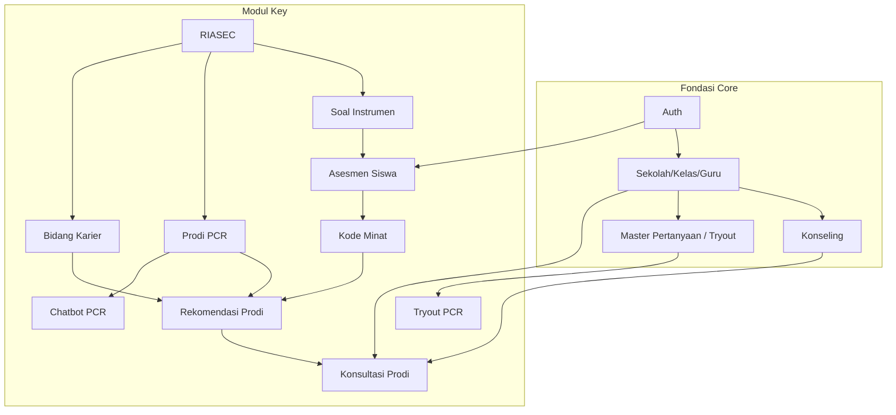
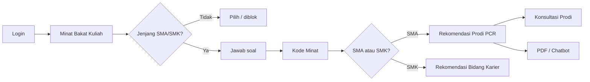
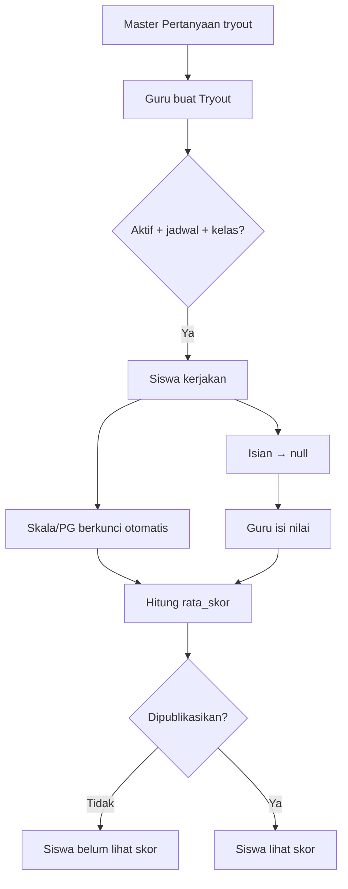

# Modul Key — Panduan Lengkap Fitur, Urutan Setup, Flow & Rumus

**Modul Key** = jalur **lanjut kuliah** di Sistem BK.

Tujuan singkat: siswa mengenal minat (RIASEC / Holland) → mendapat rekomendasi **prodi PCR** (SMA) atau **bidang karier** (SMK) → bisa **konsultasi prodi** ke Guru BK atau tanya **Chatbot** (info resmi PCR/PMB).

Dokumen ini mencakup **seluruh fitur Key** + fondasi Core yang wajib ada + rumus perhitungan.

---

## Daftar isi

1. [Apa itu Key vs Yola](#1-apa-itu-key-vs-yola)
2. [Inventaris fitur Key lengkap](#2-inventaris-fitur-key-lengkap)
3. [Hubungan dengan Phase Core 1–9](#3-hubungan-dengan-phase-core-19)
4. [Urutan setup global (dari kosong)](#4-urutan-setup-global-dari-kosong)
5. [Fitur Admin Key](#5-fitur-admin-key)
6. [Fitur Guru Key](#6-fitur-guru-key)
7. [Fitur Siswa Key](#7-fitur-siswa-key)
8. [Tryout & Master Pertanyaan (terhubung Key)](#8-tryout--master-pertanyaan-terhubung-key)
9. [Chatbot PCR](#9-chatbot-pcr)
10. [Rumus perhitungan](#10-rumus-perhitungan)
11. [Status & aturan bisnis](#11-status--aturan-bisnis)
12. [Seeder & data uji](#12-seeder--data-uji)
13. [Checklist uji lengkap](#13-checklist-uji-lengkap)
14. [Referensi teknis](#14-referensi-teknis)

---

## 1. Apa itu Key vs Yola

| | **Key (Lanjut Kuliah)** | **Yola (Siap Kerja)** |
| --- | --- | --- |
| Fokus | Kuliah / prodi PCR | Kerja / asesmen diri |
| Asesmen utama | **Minat Bakat Kuliah** (`minat_bakat`) | Minat Bakat Kerja, gaya belajar, kepribadian, masalah, sosiometri |
| Rekomendasi | Prodi PCR (SMA) / Bidang Karier (SMK) | Bidang karier + instrumen lain |
| Konsultasi khusus | **Konsultasi Prodi** | Konseling umum |
| Menu sidebar | section `key` | section `yola` |

> Bank soal RIASEC dipakai bersama, tapi **menu & hasil Key** mengarah ke kuliah/PCR; **Yola** mengarah ke kerja.

### Dua bank soal (jangan campur)

| Bank | Tabel | Dipakai untuk |
| --- | --- | --- |
| **Soal Instrumen** | `instrument_questions` | Minat Bakat Kuliah (Key) |
| **Master Pertanyaan** | `master_questions` | Angket & **Tryout** (bisa soal PMB/PCR) |

---

## 2. Inventaris fitur Key lengkap

### A. Inti Key (menu section `key`)

| # | Fitur | Role | Menu / route |
| --- | --- | --- | --- |
| K1 | **Kategori Minat RIASEC** | Admin | Karier Lanjut Kuliah → `admin.interest-categories.*` |
| K2 | **Program Studi PCR** | Admin | Karier Lanjut Kuliah → `admin.program-studi.*` |
| K3 | **Bidang Karier** | Admin | Karier Lanjut Kuliah → `admin.bidang-karier.*` |
| K4 | **Soal Minat Bakat Kuliah** | Guru | Lanjut Kuliah → `guru.instrument-questions.*?module=key` |
| K5 | **Hasil Minat Bakat Kuliah** | Guru | Lanjut Kuliah → `guru.instrument-results.*?module=key` |
| K6 | **Minat Bakat Kuliah** (asesmen + hasil + PDF) | Siswa | Lanjut Kuliah → `siswa.minat-bakat.*` + `siswa.instruments.hasil*` |
| K7 | **Konsultasi Prodi** | Siswa (+ Guru proses di Konseling) | `siswa.konsultasi-prodi.*` |

### B. Pendukung Key (bukan menu Key, tapi dipakai jalur kuliah)

| # | Fitur | Role | Mengapa terkait Key |
| --- | --- | --- | --- |
| P1 | **Auth & Role** | Semua | Login dulu |
| P2 | **Sekolah / Kelas / Siswa / Guru BK** | Admin | Scoping sekolah, penerima konsultasi, target tryout |
| P3 | **Konseling** | Guru/Siswa/Admin | Infrastruktur proses Konsultasi Prodi (`case_category=prodi_kuliah`) |
| P4 | **Master Pertanyaan** | Admin/Guru | Bank soal tryout/angket (bisa PMB PCR) |
| P5 | **Tryout** | Guru/Siswa | Latihan soal (termasuk PCR); publish skor |
| P6 | **Chatbot Konseling** | Siswa | Knowledge PCR/PMB resmi |
| P7 | **Dashboard cards** | Semua | Pintasan Minat Bakat, Konsultasi Prodi, Tryout, Chatbot |
| P8 | **Matriks Talents Mapping** | Guru | `guru.instrument-results.matrix` — ringkas RIASEC per siswa |
| P9 | **Artikel BK / Info Karier** | Admin/Siswa | Konten pendukung keputusan (bukan katalog prodi) |

---

## 3. Hubungan dengan Phase Core 1–9

| Phase | Nama | Dipakai Key untuk |
| --- | --- | --- |
| 1 | Foundation & Auth | Login Admin/Guru/Siswa |
| 2 | Data Master | Sekolah, kelas, Guru BK, Master Pertanyaan |
| 3 | Konseling & Jadwal | Konsultasi Prodi (status, jadwal, kalender) |
| 4 | Penilaian & Angket | Angket dari master pertanyaan |
| 5 | Rapor BK | Dokumen layanan (terpisah dari hasil minat bakat) |
| 6 | Tryout | Tryout kelas + publish skor |
| 7 | Postingan | Artikel BK pendukung |
| 8 | API Layer | Opsional integrasi |
| 9 | Finalisasi | Uji end-to-end multi-role |



---

## 4. Urutan setup global (dari kosong)

Lakukan **berurutan**. Jangan loncat ke fitur yang bergantung data di atasnya.

```text
LANGKAH FONDASI (Core)
  1. Migrasi + seed dasar
  2. Sekolah
  3. Kelas (jenjang SMA/SMK penting untuk Key)
  4. Guru BK (approved, terikat sekolah)
  5. Siswa (kelas + biodata; jenjang dari kelas/sekolah)

LANGKAH KEY — DATA MASTER
  6. Kategori Minat RIASEC (biasanya seed: R I A S E C)
  7. Program Studi PCR
       → tautkan minat + relevansi
       → aktif = Ya
       → is_verified = Ya   ← WAJIB agar rekomendasi muncul
  8. Bidang Karier (untuk SMK)
       → tautkan minat + relevansi + aktif

LANGKAH KEY — SOAL ASESMEN
  9. Soal Minat Bakat Kuliah (Guru)
       → category = minat_bakat
       → interest_category_id wajib
       → bobot 1–5
       → opsi Likert + score
       → jenjang_target: semua / SMA / SMK
       → aktif

LANGKAH KEY — PENDUKUNG
 10. Master Pertanyaan kategori tryout (opsional, soal PMB/PCR)
 11. Tryout (opsional)
 12. Chatbot service + index knowledge PCR (opsional tapi disarankan)

BARU SIAP DIGUNAKAN SISWA
 13. Siswa isi Minat Bakat Kuliah
 14. Lihat Kode Minat + rekomendasi
 15. Konsultasi Prodi / Chatbot / Tryout
```

---

## 5. Fitur Admin Key

### 5.1 Kategori Minat RIASEC (K1)

**Apa:** Enam huruf Holland yang jadi “ember” skor minat.

| Kode | Nama |
| --- | --- |
| R | Realistic |
| I | Investigative |
| A | Artistic |
| S | Social |
| E | Enterprising |
| C | Conventional |

**Field penting:** `kode`, `nama`, `deskripsi`, `warna`, `urutan`, `is_active`.

**Harus ada dulu:** — (paling dasar Key).

**Biasanya:** sudah diisi `InterestCategorySeeder`. Admin hanya edit deskripsi/warna/aktif bila perlu.

---

### 5.2 Program Studi PCR (K2)

**Apa:** Katalog prodi Politeknik Caltex Riau untuk rekomendasi siswa **SMA**.

**Field penting:**

| Field | Arti |
| --- | --- |
| `nama`, `institusi`, `jenjang_pendidikan`, `jurusan` | Identitas prodi |
| `deskripsi`, `prospek_karier`, `website_url` | Info tampilan |
| `is_active` | Tampil di sistem |
| `is_verified` | **Lolos admin** → baru masuk rekomendasi & dropdown konsultasi |
| Pivot `relevansi` ke RIASEC | Seberapa cocok prodi dengan huruf minat (biasanya 1–3) |
| `kode_tag` (computed) | 1–2 kode minat terkuat prodi, contoh `I-C` |

**Urutan setup:**

```text
RIASEC ada → Tambah prodi → Tautkan minat + relevansi → Aktif → Verifikasi
```

**Tanpa verifikasi:** siswa melihat pesan bahwa prodi ada tapi belum diverifikasi Admin.

---

### 5.3 Bidang Karier (K3)

**Apa:** Katalog bidang karier untuk rekomendasi siswa **SMK** (dan juga dipakai jalur Yola Minat Kerja).

**Urutan:** sama seperti prodi — RIASEC → bidang → tautan + relevansi → aktif.

---

### 5.4 Pantau Konseling Prodi

Admin membuka Konseling, filter kategori **Prodi Kuliah** — read-only pantau pengajuan lintas sekolah.

---

## 6. Fitur Guru Key

### 6.1 Soal Minat Bakat Kuliah (K4)

**Menu:** Lanjut Kuliah (Key) → Soal Minat Bakat Kuliah (`module=key`).

**Harus ada dulu:** Kategori RIASEC.

**Isi tiap soal:**

| Field | Wajib | Keterangan |
| --- | --- | --- |
| `category` | Ya | `minat_bakat` |
| `interest_category_id` | Ya | Huruf RIASEC soal ini |
| `question` | Ya | Teks soal |
| `options` | Ya | Label + `score` (Likert baku 1–5) |
| `bobot` | Disarankan | 1–5 (default 1) |
| `jenjang_target` | Disarankan | `semua` / `SMA` / `SMK` |
| `talent_code` | Opsional | Kode Talents Mapping |
| `is_active` | Ya | Hanya aktif yang dikerjakan siswa |

**Opsi Likert baku (Talents Mapping):**

| Label | Score |
| --- | --- |
| Sangat Tidak Suka | 1 |
| Tidak Suka | 2 |
| Netral | 3 |
| Suka | 4 |
| Sangat Suka | 5 |

---

### 6.2 Hasil Minat Bakat Kuliah (K5)

**Menu:** Hasil Minat Bakat Kuliah (`module=key`).

Guru melihat submission siswa bimbingan: Kode Minat, skor kategori, tanggal.

**Bonus:** Matriks Talents Mapping — baris siswa × kolom RIASEC (hasil terakhir).

**Scope:** hanya siswa yang bisa diakses Guru BK (`CounselorStudentService`).

---

### 6.3 Proses Konsultasi Prodi (via Konseling)

Bukan menu Key terpisah. Masuk **Layanan BK → Konseling**.

Pengajuan dengan `case_category = prodi_kuliah` menampilkan badge **Prodi: …**.

**Flow status (sama konseling Phase 3):**

```text
Menunggu → Disetujui / Ditolak / Dijadwalkan ulang → Selesai
```

Guru bisa jadwalkan, isi lokasi/teknik, laporan, follow-up, cetak PDF (jika tersedia di modul konseling).

---

### 6.4 Master Pertanyaan + Tryout (pendukung)

Lihat [§8](#8-tryout--master-pertanyaan-terhubung-key).

---

## 7. Fitur Siswa Key

### 7.1 Minat Bakat Kuliah (K6) — fitur inti

**Menu:** Lanjut Kuliah → Minat Bakat Kuliah.

**Harus ada dulu:**

```text
RIASEC → Prodi verified (SMA) / Bidang Karier (SMK) → Soal instrumen aktif
→ Siswa punya jenjang SMA/SMK (dari profil/kelas; atau pilih di UI)
```

**Aturan jenjang:**

| Kondisi | Perilaku |
| --- | --- |
| Profil SMA/SMK | Langsung kerjakan; soal difilter `jenjang_target` |
| Jenjang belum jelas | Tampil pemilih SMA/SMK |
| SD/SMP | Diblok — asesmen untuk SMA/SMK |

**Flow siswa:**

```text
1. Buka Minat Bakat Kuliah
2. Jawab semua soal Likert
3. Submit
4. Lihat hasil:
   - Persen per huruf RIASEC
   - Kode Minat (3 huruf teratas, mis. IAC)
   - Label minat dominan + deskripsi
   - Rekomendasi (maks 6):
       SMA → Program Studi PCR
       SMK → Bidang Karier
5. Unduh PDF hasil (opsional)
6. Klik “Konsultasikan prodi ini” (SMA) → form Konsultasi Prodi terisi
```



---

### 7.2 Konsultasi Prodi (K7)

**Menu:** Lanjut Kuliah → Konsultasi Prodi.

**Harus ada dulu:**

```text
Guru BK approved (prioritas sekolah siswa)
→ Prodi aktif + verified (untuk dropdown)
→ (Ideal) siswa sudah lihat rekomendasi
```

**Yang diisi siswa:** Guru BK, Program Studi, subjek, detail, preferensi tanggal/waktu.

**Sistem set:** `case_category = prodi_kuliah`, `status = menunggu`.

**Riwayat:** filter status (Menunggu / Disetujui / Ditolak / Dijadwalkan ulang / Selesai).

**Prefill:** dari hasil minat bakat via query `program_studi_id` + `subject`.

---

### 7.3 Chatbot & Tryout (dari dashboard / Layanan BK)

Lihat §8 dan §9. Pintasan ada di dashboard siswa.

---

## 8. Tryout & Master Pertanyaan (terhubung Key)

Tryout **bukan** menu Key, tapi sering dipakai untuk soal PMB/PCR.

### Harus nambah apa dulu (urut wajib)

```text
① Sekolah
② Kelas
③ Guru BK + Siswa (siswa masuk kelas)
④ Master Pertanyaan
     - kategori = tryout
     - tipe = skala / pilihan_ganda / isian
     - untuk PG: isi kunci_jawaban
     - is_active = Ya
⑤ Guru buat Tryout
     - judul, durasi, mulai_at, selesai_at
     - pilih soal (hanya dari master kategori tryout)
     - pilih kelas
     - status aktif
⑥ Siswa kerjakan (dalam jadwal + kelas cocok)
⑦ Guru nilai isian/esai (dan PG tanpa kunci)
⑧ Guru Publikasikan hasil
⑨ Siswa lihat skor di riwayat
```

### Penjelasan cepat

| Tanpa ini… | Akibat |
| --- | --- |
| Master Pertanyaan tryout | Form tryout kosong (tidak ada soal) |
| Kelas siswa tidak dipilih | Siswa tidak bisa akses |
| Di luar jadwal | Siswa tidak bisa kerjakan |
| Belum publikasi | Siswa **tidak** melihat skor |
| Isian belum dinilai | Skor soal = null, tidak masuk rata-rata |

### Tipe soal & cara skor

| Tipe | Otomatis? | Rumus / aturan |
| --- | --- | --- |
| Skala 1–5 | Ya | `jawaban × 20` → 20…100 |
| Pilihan ganda + kunci | Ya | benar 100 / salah 0 |
| Pilihan ganda tanpa kunci | Manual | null sampai Guru isi |
| Isian / esai | Manual | Guru isi 0–100 |

### Rumus rata-rata tryout

\[
\text{rata\_skor} = \text{avg}(\text{semua skor soal yang bukan null})
\]

```text
Contoh:
  A skala=4 → 80
  B PG benar → 100
  C isian belum dinilai → null
  rata = (80+100)/2 = 90.0

Setelah C = 70:
  rata = (80+100+70)/3 = 83.3
```

### Flow Tryout



---

## 9. Chatbot PCR + Konseling

**Menu siswa:** Layanan BK → Chatbot Konseling.

**Harus ada dulu (lokal / VPS / cloud):**

```text
① Python 3.11–3.13 + venv di chatbot_service/
② cp .env.example .env → set CHATBOT_API_TOKEN (wajib di server)
③ python ingest_buku.py  (wajib tiap server; index tidak di-commit)
④ uvicorn / systemd bind 127.0.0.1:8001
⑤ Laravel: CHATBOT_SERVICE_URL + CHATBOT_API_TOKEN sama
⑥ Siswa login → Chatbot
```

**Perilaku:** jawaban terkurasi BK/PCR + FTS knowledge; follow-up memakai riwayat; jadwal PCR selalu diarahkan ke situs resmi; topik di luar scope ditolak; krisis diarahkan ke Guru BK + hotline.

Detail deploy: `chatbot_service/README.md`.

---

## 10. Rumus perhitungan

### 10.1 Skor Minat Bakat (RIASEC)

Per soal: opsi punya `score`, soal punya `bobot` (min 1).

**Skor mentah kategori \(k\):**

\[
\text{raw}_k = \sum_i (\text{score}_{i} \times \text{bobot}_{i})
\]

**Skor maksimum kategori \(k\):**

\[
\text{max}_k = \sum_i (\text{score tertinggi opsi soal}_i \times \text{bobot}_{i})
\]

**Persentase:**

\[
\text{persen}_k = \mathrm{round}\!\left(\frac{\text{raw}_k}{\text{max}_k} \times 100,\ 1\right)
\]

**Peringkat:** `persen` ↓, lalu `raw` ↓, lalu `urutan` kategori ↑.

**Kode Minat:** gabungan kode **3 kategori teratas** → contoh `IAC`.

**Tie:** jika \(|\text{persen}_1 - \text{persen}_2| < 0.5\) → `is_tied = true`.

**Inconclusif:** semua persen = 0 → Kode Minat tidak dianggap kecenderungan nyata.

```text
Contoh:
  I: raw=36 max=40 → 90.0%
  A: raw=28 max=40 → 70.0%
  C: raw=24 max=40 → 60.0%
  → Kode Minat = IAC
```

---

### 10.2 Rekomendasi Prodi / Bidang Karier

Ambil Top-3 minat siswa, beri bobot:

| Peringkat | Bobot |
| --- | --- |
| Top 1 | **1.0** |
| Top 2 | **0.6** |
| Top 3 | **0.3** |

**Skor kecocokan item (prodi/karier):**

\[
\text{score} = \sum (\text{relevansi pivot} \times \text{bobot peringkat minat})
\]

Aturan lanjut:
- Filter `score > 0`
- Urut skor tertinggi
- Ambil **maksimal 6**
- Label: `score ≥ 3` → **Sangat Cocok**, selain itu **Cocok**

**Filter prodi SMA:** `is_active` + `is_verified` + punya tautan ke Top-3 minat.

```text
Contoh:
  Top minat: I(1.0), A(0.6), C(0.3)
  Prodi RPL: I relevansi 3, A relevansi 2
  score = 3×1.0 + 2×0.6 = 4.2 → Sangat Cocok
```

---

### 10.3 Skor Tryout

| Tipe | Rumus |
| --- | --- |
| Skala | \(\text{jawaban} \times 20\) (clamp 1–5) |
| PG berkunci | 100 jika sama kunci, else 0 |
| PG tanpa kunci / isian | null → Guru isi 0–100 |
| Rata-rata | avg skor non-null, dibulatkan 1 desimal |

---

## 11. Status & aturan bisnis

### Konsultasi / Konseling Prodi

| Status | Arti |
| --- | --- |
| Menunggu | Baru diajukan |
| Disetujui | Guru setuju (siap dijadwal / sudah dijadwal) |
| Ditolak | Ditolak + alasan |
| Dijadwalkan ulang | Jadwal diganti |
| Selesai | Sesi selesai + laporan |

Penerima Guru: prioritas Guru BK **sekolah siswa**; fallback guru approved lain.

### Tryout

| Flag | Arti |
| --- | --- |
| `status` draft/aktif | Siapa yang melihat daftar aktif |
| `mulai_at`–`selesai_at` | Jendela pengerjaan |
| `hasil_dipublikasikan` | Kunci tampilan skor ke siswa |

### Prodi

| Flag | Arti |
| --- | --- |
| `is_active` | Masih dipakai sistem |
| `is_verified` | Lolos cek Admin → rekomendasi + dropdown konsultasi |

---

## 12. Seeder & data uji

Dipanggil dari `DatabaseSeeder` (urutan relevan Key):

| Seeder | Isi |
| --- | --- |
| `InterestCategorySeeder` | R,I,A,S,E,C |
| `MinatQuestionSeeder` | Soal instrumen Minat Bakat |
| `ProgramStudiPcrSeeder` | Prodi PCR + tautan minat |
| `CareerFieldSeeder` | Bidang karier + tautan |
| `MasterQuestionSeeder` | Soal angket/tryout contoh |

Setelah seed/migrate, pastikan prodi yang mau tampil di rekomendasi sudah **`is_verified = true`** (di admin atau data uji yang disepakati).

---

## 13. Checklist uji lengkap

### Fondasi
- [ ] Login Admin / Guru / Siswa
- [ ] Sekolah ≥1, Kelas SMA & SMK, Guru approved, Siswa punya kelas

### Admin Key
- [ ] 6 kategori RIASEC aktif
- [ ] Prodi PCR aktif + verified + relevansi
- [ ] Bidang Karier aktif + relevansi

### Guru Key
- [ ] Soal Minat Bakat Kuliah aktif (ada `interest_category_id`)
- [ ] Hasil Minat Bakat terlihat untuk siswa bimbingan
- [ ] Konseling menampilkan badge Prodi

### Siswa Key
- [ ] SMA: isi Minat Bakat → Kode Minat + daftar prodi
- [ ] SMK: isi Minat Bakat → Kode Minat + bidang karier
- [ ] PDF hasil bisa diunduh
- [ ] Tombol konsultasi prodi → form terisi
- [ ] Status konsultasi berubah setelah Guru proses

### Tryout
- [ ] Soal master kategori tryout (skala, PG berkunci, isian)
- [ ] Tryout aktif + kelas + jadwal
- [ ] Skor skala/PG otomatis; isian manual
- [ ] Sebelum publish: skor tersembunyi; sesudah: terlihat

### Chatbot
- [ ] Service up + index PCR
- [ ] Tanya “Jalur masuk PCR” / “Biaya PCR” berdasar knowledge resmi

---

## 14. Inventaris field form CRUD Key

| Form | Field wajib | Field opsional / catatan |
| --- | --- | --- |
| **Kategori Minat RIASEC** | `kode` (A–Z), `nama`, `is_active` | `deskripsi`, `warna` (#hex + color picker), `urutan` |
| **Program Studi PCR** | `institusi`, `nama`, `jenjang` (D3/D4), `is_verified`, `is_active`, **≥1 kategori + relevansi 1–3** | `jurusan`, `deskripsi`, `prospek_karier`, `website_url` |
| **Bidang Karier** | `nama`, `is_active`, **≥1 kategori + relevansi 1–3** | `deskripsi`, `contoh_pekerjaan` (per baris), `job_zone` 1–5 |
| **Soal Minat Bakat (Guru Key)** | `category=minat_bakat`, `question`, `talent_code`, `interest_category_id` (auto), `options` (≥2), `is_active` | `jenjang_target` (semua/SMA/SMK), `bobot` 1–5 |
| **Konsultasi Prodi (Siswa)** | `subject`, `program_studi_id` (verified), `counselor_id`, `details` | `preferred_date` (≥ hari ini), `preferred_time` |
| **Asesmen Minat Bakat (Siswa)** | `category`, `jenjang` (SMA/SMK), `answers[id]` semua soal | — (bukan CRUD master) |
| **Hasil Minat Bakat (Guru)** | — | Read-only (tidak ada form edit) |

---

## 15. Referensi teknis

| Topik | Lokasi |
| --- | --- |
| Menu Key | `config/navigation.php` (`section => key`) |
| Scoring RIASEC | `app/Services/Minat/InterestScoringService.php` |
| Rekomendasi | `app/Services/Minat/RecommendationService.php` |
| Hasil + metadata | `app/Services/Minat/InterestResult.php` |
| Tryout skor/publish | `app/Services/TryOutService.php` |
| Asesmen siswa Key | `siswa.minat-bakat.index`, `InstrumentSubmissionController` |
| Konsultasi Prodi | `ProdiConsultationController`, `CASE_PRODI_KULIAH` |
| Chatbot | `chatbot_service/`, `siswa.chatbot.*` |
| Rule implementasi | `.cursor/rules/minat-bakat.mdc` |
| Tracker Core | `docs/CORE_TEAM_TRACKER.md` |

---

## Ringkasan satu halaman

```text
ADMIN:  RIASEC → Prodi PCR (verified) → Bidang Karier
GURU:   Soal Minat Bakat → pantau Hasil → proses Konsultasi di Konseling
        (+ Master Pertanyaan → Tryout → nilai → publish)
SISWA:  Minat Bakat Kuliah → Kode Minat + rekomendasi
        → Konsultasi Prodi / Chatbot / Tryout / PDF
```

**Rumus inti:**
- Minat: `persen = (raw/max)×100` → Top-3 = Kode Minat  
- Prodi: `score = Σ(relevansi × bobot Top1/2/3)` → max 6 item  
- Tryout: skala×20; PG 0/100; rata-rata non-null; tampil setelah publish  
